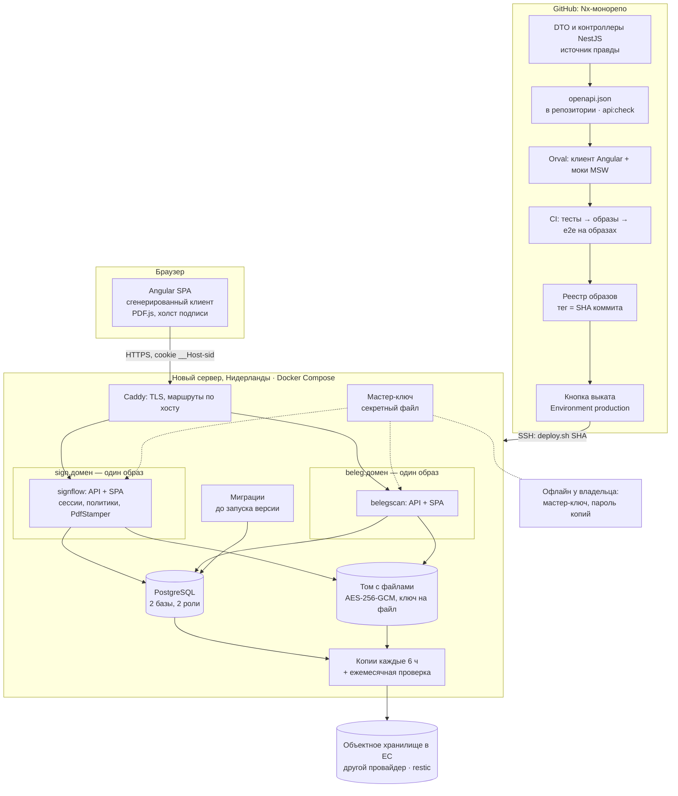

# Волна 1: схема архитектуры и план задач (редакция 2, после правок владельца)

## 1. Список ADR

| №    | Решение                                                                            | Волна       | Статус                          |
| ---- | ---------------------------------------------------------------------------------- | ----------- | ------------------------------- |
| 0007 | API-контракт: REST + OpenAPI 3.1, code-first, Orval, моки, `api:check`, границы Nx | 1           | Accepted                        |
| 0008 | Конвенции API, включая деньги                                                      | 1           | Accepted                        |
| 0009 | Окружения и настройки                                                              | 1           | Accepted                        |
| 0010 | Аутентификация                                                                     | 1           | Accepted                        |
| 0011 | Авторизация                                                                        | 1           | Accepted                        |
| 0012 | Файлы: хранение, шифрование, проверка загрузок                                     | 1           | Accepted                        |
| 0013 | Обработка PDF                                                                      | 1           | Accepted, library pending spike |
| 0014 | Рабочее развёртывание                                                              | 1           | Accepted                        |
| 0015 | Почта                                                                              | 2           | Proposed                        |
| 0016 | Доступ без аккаунта: ссылка + одноразовый код                                      | 2           | Proposed                        |
| 0017 | Протокол и удаление                                                                | 2           | Proposed                        |
| 0018 | Обновление данных: опрос, условие перехода на SSE                                  | 2           | Proposed                        |
| 0019 | Хостинг демо и песочница на посетителя                                             | 2           | Proposed                        |
| 0020 | Мониторинг ошибок, журналы, проверка здоровья                                      | 2           | Proposed                        |
| 0021 | Формы в приложениях (Reactive Forms или Signal Forms) — **пишет Claude Code**      | до задачи 8 | —                               |
| 0022 | Иконки (`lucide-angular`) — **пишет Claude Code**                                  | до задачи 8 | —                               |
| 0023 | Распознавание: модель по результату спайка                                         | 3           | —                               |
| 0024 | Офлайн-хранилище, синхронизация, конфликты                                         | 3           | —                               |
| 0025 | Пакетный импорт в браузере                                                         | 3           | —                               |
| 0026 | Модель налоговых строк и фискальных проверок                                       | 3           | —                               |
| 0027 | Электронные счета ZUGFeRD / XRechnung                                              | 3           | —                               |
| 0028 | Экспорт CSV                                                                        | 3           | —                               |

Номера 0015–0020 не сдвигал: вы на них уже ссылаетесь. ADR про формы и иконки получили
0021 и 0022, волна 3 сдвинулась на 0023–0028 (она ещё не написана).

## 2. Схема архитектуры после волны 1

Схема с почтой, демо и мониторингом — в [`architecture-wave2.md`](architecture-wave2.md).

## 3. Что нужно от вас до начала (не код)

| Что                                                                        | Для какой задачи |
| -------------------------------------------------------------------------- | ---------------- |
| Купить домен, заказать сервер, создать DNS-записи                          | 23, 24           |
| Завести хранилище для копий в ЕС у другого провайдера                      | 25               |
| Создать в GitHub Environment `production` с обязательным подтверждением    | 24               |
| Исправить макеты (печать в палитре, «geplant», галочка, баннер, глоссарий) | до экранов       |

Набор PDF для спайка собирать **не нужно**: он только синтетический, его создаёт
Claude Code в задаче 13.

## 4. План задач для Claude Code

Правила: одна задача — один PR до ~400 изменённых строк (сгенерированные файлы не
считаются), сначала красный тест, в конце рабочий результат, зелёный CI и запись в журнале.
Все эндпоинты — примеры.

Обозначения: **число** — задача этого плана; **UI-n** — компонент `libs/ui` (каждый —
отдельная задача по вашим правилам: спецификация из `docs/design`, история в Storybook,
axe, клавиатура); **ADR-0021 / ADR-0022** — решения, которые пишет Claude Code.

### Этап A. Сквозной срез и контракт

| №   | Задача                                                                                                                                                                                                                                                                                                                                                             | Рабочий результат                                  | Зависит от |
| --- | ------------------------------------------------------------------------------------------------------------------------------------------------------------------------------------------------------------------------------------------------------------------------------------------------------------------------------------------------------------------ | -------------------------------------------------- | ---------- |
| 1   | **Сквозной срез.** `GET /api/v1/health` в `signflow-api` (Nest 12) → `openapi.json` → Orval-клиент → строка «API: ок, версия …» на экране SignFlow → тест компонента на моке MSW → e2e против настоящего API. Проверить: Nest 12 + Prisma + class-validator работают вместе; документ объявляет 3.1.0; статус `httpResource`. Экран без иконок и новых компонентов | Экран показывает версию API                        | —          |
| 2   | `api:check` в CI. Мутационная проверка: изменить DTO без перегенерации → CI красный. Теги Nx и правила границ из ADR-0007; тест, что импорт серверной библиотеки во фронтенд — ошибка lint. Строка в CLAUDE.md про типы                                                                                                                                            | Расхождение контракта и нарушение границ ломают CI | 1          |
| 3   | Ошибки RFC 9457: фильтр исключений, реестр кодов, схема в контракте; на фронте — преобразование кода в перевод; `i18n-check` проверяет коды                                                                                                                                                                                                                        | Ошибка валидации показана на de/en/ru              | 2          |
| 4   | Настройки: типизированный модуль с проверкой при старте, `/api/v1/config`, инициализатор на фронте, `.env.example` и его проверка                                                                                                                                                                                                                                  | Неверная переменная останавливает запуск           | 2          |
| 5   | PostgreSQL и Prisma: Compose для разработки (Postgres, Mailpit), первая миграция, каркас интеграционных тестов на Testcontainers, применение всех миграций в CI                                                                                                                                                                                                    | Интеграционный тест ходит в базу                   | 4          |
| 6   | `libs/shared/api-kit`: DTO страницы и сортировки, `Money`, `DecimalString`, **таблица валют с показателем ISO 4217**, преобразование `bigint`, UUIDv7; тесты: разные валюты не складываются, неизвестная валюта → 422                                                                                                                                              | Библиотека с тестами                               | 3, 5       |

### Этап A2. Основа интерфейса (перед первыми экранами)

| №        | Задача                                               | Нужна для  |
| -------- | ---------------------------------------------------- | ---------- |
| ADR-0021 | Формы в приложениях: Reactive Forms или Signal Forms | 8          |
| ADR-0022 | Иконки: `lucide-angular`                             | 8          |
| UI-1     | Spinner / Progress                                   | 8, 16, 20  |
| UI-2     | Toast                                                | 8          |
| UI-3     | Dialog                                               | 10, 17, 21 |
| UI-4     | SideNav                                              | 8a         |
| UI-5     | Breadcrumbs                                          | 16         |
| UI-6     | DataTable                                            | 10, 16     |
| UI-7     | Pagination                                           | 16         |
| UI-8     | Tabs                                                 | 16, 21     |
| UI-9     | FileDrop                                             | 16, 17     |
| UI-10    | DropdownMenu                                         | 10, 16     |
| —        | Badge, Avatar, Tag (уже в работе)                    | 8a, 10, 16 |

Компоненты можно делать параллельно с этапами A и B; порядок внутри — по первой задаче,
которой они нужны: UI-1, UI-2, UI-4 → UI-3, UI-6, UI-10 → UI-5, UI-7, UI-8, UI-9.

### Этап B. Вход и права

| №   | Задача                                                                                                                                                                                                   | Рабочий результат                                                                                 | Зависит от                        |
| --- | -------------------------------------------------------------------------------------------------------------------------------------------------------------------------------------------------------- | ------------------------------------------------------------------------------------------------- | --------------------------------- |
| 7   | Сессии: таблицы `users`, `sessions`; Argon2id; вход, выход, «кто я»; cookie `__Host-sid`; проверка `Origin`; ограничение попыток по паре «аккаунт + IP» и по IP; команда создания первого администратора | Вход через API; тесты: чужой origin — отказ, перебор с одного IP не блокирует владельца с другого | 5                                 |
| 8   | Фронт: экран входа, хранилище сессии (SignalStore), guard маршрутов, обработка 401; e2e входа                                                                                                            | Можно войти и выйти в браузере                                                                    | 7, ADR-0021, ADR-0022, UI-1, UI-2 |
| 8a  | Каркас приложения SignFlow: боковое меню, шапка, пользователь, переключатель языка                                                                                                                       | Вошедший пользователь видит каркас                                                                | 8, UI-4, Avatar                   |
| 9   | Авторизация: глобальный guard «запрещено по умолчанию», `@Policy`, `@Public`, тест «у каждого маршрута есть политика», флаг администратора                                                               | Маршрут без политики не проходит CI                                                               | 7                                 |
| 10  | Приглашения: создание администратором, письмо через порт `Mailer` (локально Mailpit), принятие и установка пароля; экраны                                                                                | Новый пользователь входит по приглашению                                                          | 8a, 9, UI-3, UI-6, UI-10, Badge   |
| 11  | Восстановление пароля, смена e-mail с подтверждением, письмо владельцу при блокировке аккаунта; экраны                                                                                                   | Пароль можно сбросить                                                                             | 10                                |

### Этап C. Файлы и PDF

| №   | Задача                                                                                                                                                                                                                                                                | Рабочий результат                           | Зависит от               |
| --- | --------------------------------------------------------------------------------------------------------------------------------------------------------------------------------------------------------------------------------------------------------------------- | ------------------------------------------- | ------------------------ |
| 12  | `FileStore` (диск) и конвертное шифрование; тесты: подмена байта, чужой id, неверный ключ → ошибка; команда ротации мастер-ключа                                                                                                                                      | Файл шифруется и читается, ротация работает | 5                        |
| 13  | **Спайк PDF.** Набор **только синтетических или открытых** файлов (README с происхождением каждого), интерфейс `PdfStamper`, реализация на `@cantoo/pdf-lib`, критерии из ADR-0013; при провале — LibPDF на том же наборе. Итог в журнале, уточнение статуса ADR-0013 | Решение о библиотеке с доказательствами     | —                        |
| 14  | Проверка загрузки PDF в изолированном потоке: размер, магические байты, пароль, число страниц, JavaScript и launch-действия, **вложенные файлы — отказ**, флаг существующей подписи; коды ошибок                                                                      | Плохие PDF отклоняются с понятным кодом     | 3, 13                    |
| 15  | Документ: модель (документ, версии файла, события протокола), загрузка → черновик, отпечаток, событие; список с пагинацией и политикой «только мои»                                                                                                                   | PDF загружается и виден в списке через API  | 6, 9, 12, 14             |
| 16  | Фронт: загрузка PDF и список документов на настоящем API                                                                                                                                                                                                              | Экран «Dokumente» работает                  | 8a, 15, UI-1, UI-5…UI-10 |
| 17  | Профиль: подпись и печати (PNG, лимиты), API и экран                                                                                                                                                                                                                  | Подпись и печати сохраняются                | 12, 16, UI-3, UI-9       |
| 18  | Простановка: пересчёт координат (с поворотом страниц), вставка картинки и текста, дописывание в конец, отпечаток версии                                                                                                                                               | Тесты на наборе PDF зелёные                 | 13, 15                   |
| 19  | Страница протокола: шрифт для кириллицы и ң, ө, ү; язык по выбору в документе; IP по настройке (по умолчанию скрыт частично); итоговый отпечаток; скачивание                                                                                                          | Итоговый PDF с протоколом скачивается       | 18                       |
| 20  | Фронт, часть 1: просмотр страниц (PDF.js) и размещение своих полей                                                                                                                                                                                                    | Поля ставятся на страницу                   | 16                       |
| 21  | Фронт, часть 2: окно подписи (нарисовать, напечатать, загрузить, из профиля), выбор печати, согласие, отправка; e2e всего процесса 0                                                                                                                                  | **Процесс 0 работает целиком**              | 17, 19, 20, UI-3, UI-8   |

### Этап D. Выкат

Можно начинать сразу после задачи 8, параллельно с этапом C.

| №   | Задача                                                                                                                        | Рабочий результат                          | Зависит от |
| --- | ----------------------------------------------------------------------------------------------------------------------------- | ------------------------------------------ | ---------- |
| 22  | Образы: многоэтапный Dockerfile (API + SPA), сборка в CI один раз, e2e против образов, публикация с тегом SHA                 | Образ в реестре после зелёного `main`      | 8          |
| 23  | `compose.yaml`, Caddyfile, контейнер миграций, проверка здоровья; runbook подготовки сервера                                  | Стек поднимается локально одной командой   | 22         |
| 24  | Выкат: workflow с вводом SHA и Environment `production`, `deploy.sh` с автооткатом, ограниченный SSH-пользователь             | Версия выкатывается и откатывается кнопкой | 23         |
| 25  | Копии: задание restic каждые 6 часов, срок хранения 35 дней, heartbeat                                                        | Копия появляется в хранилище               | 24         |
| 26  | Проверка восстановления: скрипт учения, heartbeat, `docs/runbooks/restore.md`; первое ручное восстановление на чистом сервере | Восстановление доказано                    | 12, 25     |

Belegscan в волне 1 не трогаем, кроме того, что общие библиотеки (`api-kit`,
`auth-server`, `auth-client`, `FileStore`) пишутся без привязки к SignFlow.

## 5. Принятые ответы владельца (15.11.2026)

1. Nest 12 — да; в задаче 1 проверить совместимость с Prisma и class-validator.
2. Сессия: 7 дней без активности, максимум 30.
3. RPO 6 часов, RTO 4 часа.
4. Копии живут 35 дней; формулировка для пользователей: «удалённое исчезает из резервных
   копий не позже чем через 35 дней». Юрист подтверждает.
5. Язык страницы протокола — выбор в документе, по умолчанию язык интерфейса отправителя
   в момент отправки.
6. Belegscan: группой управляет её владелец (создатель); приглашение в группу может
   создать аккаунт; участник отправляет в корзину только свои неподтверждённые чеки,
   бухгалтер — любые.
7. PDF: JavaScript и launch-действия — отказ везде; вложенные файлы — отказ в SignFlow;
   в Belegscan читается только XML ZUGFeRD / XRechnung, остальное игнорируется.
