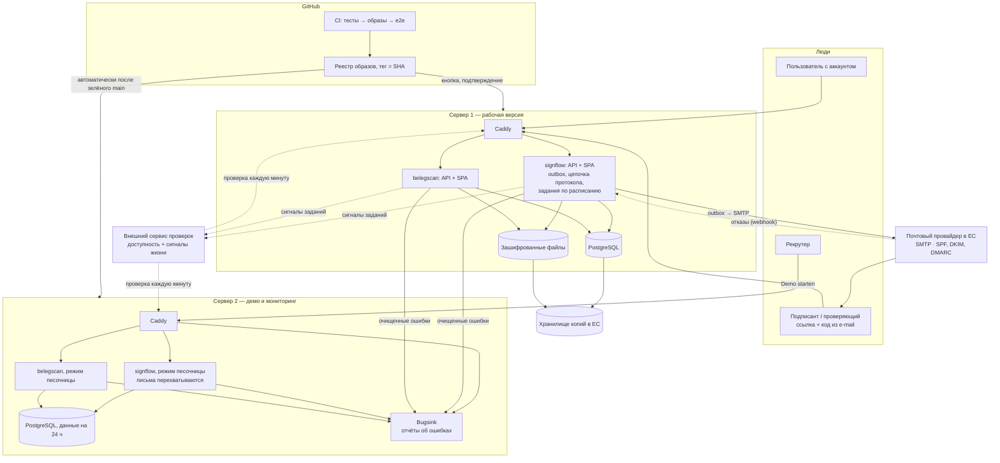

# Волна 2: схема, план задач, открытые вопросы

## 1. Схема архитектуры после волны 2

## 2. Что нужно от вас

| Что                                                                                                            | Для какой задачи |
| -------------------------------------------------------------------------------------------------------------- | ---------------- |
| Решить: платим за второй сервер (несколько евро в месяц) или принимаем риск демо на рабочем сервере — ADR-0019 | 50–52, 54        |
| Аккаунт у почтового провайдера; DNS-записи SPF, DKIM, DMARC для `mail.<домен>`                                 | 29               |
| Тестовые ящики: Gmail, Microsoft, Mail.ru, Яндекс, один корпоративный                                          | 29               |
| Аккаунт во внешнем сервисе проверок                                                                            | 52, 55           |
| Обновить `business-processes.md` §0: вместо «логин и пароль на странице демо» — кнопка «Demo starten»          | 51               |

## 3. План задач для Claude Code (продолжение нумерации)

Правила те же. Все эндпоинты — примеры. Новые компоненты `libs/ui`, которых ещё нет в
плане волны 1, отмечены как UI-n и делаются отдельными задачами перед экраном.

### Этап E. Почта

| №   | Задача                                                                                                                                              | Рабочий результат                                 | Зависит от |
| --- | --------------------------------------------------------------------------------------------------------------------------------------------------- | ------------------------------------------------- | ---------- |
| 27  | Порт `Mailer`, таблица outbox, отправщик с повторами, транспорты `smtp` (Mailpit), `capture`, `memory`; тест: откат транзакции — письма нет         | Письмо уходит в Mailpit после фиксации транзакции | 5          |
| 28  | Шаблоны писем de/en/ru (текст + простой HTML), экранирование пользовательского текста, файлы переводов сервера под `i18n-check`                     | Письма на трёх языках, снимки в тестах            | 27         |
| 29  | Провайдер: настройка SMTP, DNS, приём webhook об отказах с проверкой подписи; **тест доставки** по матрице ящиков; итог в журнале и статус ADR-0015 | Реальное письмо во «Входящих» на всех ящиках      | 24, 28     |
| 30  | Лимиты отправки, предохранитель, статус «не доставлено» у получателя                                                                                | Превышение лимита даёт понятную ошибку            | 27         |

### Этап F. Отправка другим и подписание (процессы 1 и 2)

| №     | Задача                                                                                                                                                          | Рабочий результат                | Зависит от    |
| ----- | --------------------------------------------------------------------------------------------------------------------------------------------------------------- | -------------------------------- | ------------- |
| 31    | Модель участников: подписанты, проверяющие, порядок, язык писем, поля по участникам; правило «у каждого подписанта есть поле подписи»                           | API черновика с участниками      | 15            |
| 32    | Автомат состояний документа (Entwurf → In Prüfung → Wartet → Signiert / Abgelehnt / Storniert), табличные тесты переходов; «Überfällig» как вычисляемый признак | Недопустимый переход даёт 409    | 31            |
| UI-11 | Stepper (шаги мастера)                                                                                                                                          | —                                | —             |
| 33    | Фронт «Neuer Umlauf», шаг участников и порядка                                                                                                                  | Участники добавляются            | 16, 31, UI-11 |
| 34    | Фронт: поля по участникам, включая печать; срок, сообщение, язык протокола, автосохранение                                                                      | Черновик готов к отправке        | 20, 33        |
| 35    | Отправка: письма через outbox, последовательный и параллельный порядок                                                                                          | Подписант получает письмо        | 28, 32        |
| 36    | Доступ по ссылке: токен во фрагменте, выдача и проверка кода, лимиты, блокировка, сессия участника, принципал `participant` в политиках                         | Вход по ссылке и коду через API  | 9, 35         |
| 37    | Экран подписания для участника: ввод кода, проход по полям, согласие (версия текста в протоколе), отказ с причиной                                              | Внешний подписант подписывает    | 21, 36        |
| 38    | «Входящие» для подписанта с аккаунтом (совпадение подтверждённого e-mail)                                                                                       | Документ появляется в Eingang    | 35            |
| 39    | Проверка перед подписанием: подтвердить или вернуть с замечанием; замена PDF в черновике со сбросом подписей                                                    | Этап «In Prüfung» работает       | 36            |
| 40    | Сопровождение: напомнить, аннулировать, продлить срок, исправить e-mail (старая ссылка отзывается), «скопировать как новый черновик»                            | Действия отправителя работают    | 35            |
| 41    | Завершение: страница протокола, итоговый PDF, письма участникам со ссылкой и последним хешем цепочки                                                            | Все участники получают результат | 19, 37        |

### Этап G. Протокол и удаление

| №   | Задача                                                                                                                                                                                                                               | Рабочий результат                                 | Зависит от |
| --- | ------------------------------------------------------------------------------------------------------------------------------------------------------------------------------------------------------------------------------------ | ------------------------------------------------- | ---------- |
| 42  | Цепочка хешей: каноническая сериализация с версией, `audit_pii` с солью, запрет UPDATE/DELETE для роли приложения; тесты с зафиксированными примерами                                                                                | Изменение записи обнаруживается                   | 15         |
| 43  | Команда и ночное задание `verify`; включение в проверку восстановления                                                                                                                                                               | Сбой цепочки даёт тревогу                         | 42, 55     |
| 44  | Удаление с сохранением доказательства; настройки сроков; ежедневное задание; предупреждение в интерфейсе                                                                                                                             | Удалённый документ оставляет отпечатки и протокол | 42         |
| 45  | Обезличивание документа по полному списку ADR-0017 (протокол, участники, название, сообщения, токены, сессии, счётчики, письма) и псевдонимизация одного участника; тест с метками во всех персональных полях и поиском по всей базе | Цепочка сходится, меток в базе нет                | 36, 42     |
| 46  | Экран «Details»: протокол, проверка целостности, экспорт CSV                                                                                                                                                                         | Экран работает на настоящих данных                | 41, 42     |

### Этап H. Обновление, обзор

| №   | Задача                                                                                            | Рабочий результат                               | Зависит от |
| --- | ------------------------------------------------------------------------------------------------- | ----------------------------------------------- | ---------- |
| 47  | ETag и 304 на списках и карточке; помощник опроса (таймер, видимость вкладки, отступ при ошибках) | Статус обновляется без перезагрузки             | 16         |
| 48  | Обзор: «ждут моей подписи», «ждут других», «просрочено», последние события                        | Главный экран SignFlow                          | 38, 47     |
| 49  | Массовые действия и поиск                                                                         | Напомнить, скачать, аннулировать для нескольких | 40         |

### Этап I. Демо

| №   | Задача                                                                                                                                                 | Рабочий результат                                  | Зависит от |
| --- | ------------------------------------------------------------------------------------------------------------------------------------------------------ | -------------------------------------------------- | ---------- |
| 50  | Режим песочницы: создание временного пользователя, seed (общий с e2e), срок жизни и очистка, лимиты по IP и общие, лимиты загрузки                     | «Demo starten» через API создаёт аккаунт с данными | 9, 15      |
| 51  | Разделена на 51a/51b, см. `docs/plans/roadmap.md`                                                                                                      | —                                                  | —          |
| 52  | Второй сервер: Compose для демо, автоматический выкат после зелёного `main`, `noindex`; внешняя проверка доступности адреса демо с письмом при падении | Демо обновляется само; о падении приходит письмо   | 24, 51a    |

### Этап J. Мониторинг

| №   | Задача                                                                                                                                               | Рабочий результат                         | Зависит от |
| --- | ---------------------------------------------------------------------------------------------------------------------------------------------------- | ----------------------------------------- | ---------- |
| 53  | Журналы JSON с trace id и списком скрываемых полей; `/health/live`, `/health/ready`; выкат ждёт готовности                                           | Журнал без личных данных, тест на скрытие | 4          |
| 54  | SDK Sentry в SPA и API, очистка событий с тестом, trace id в сообщении об ошибке; Bugsink на втором сервере (проверить лицензию, память, source map) | Ошибка видна в трекере без личных данных  | 52, 53     |
| 55  | Внешние проверки доступности и сигналы жизни для всех заданий; скрипт диска и сертификата; `docs/runbooks/incident.md`                               | Остановленное задание даёт тревогу        | 25, 53     |

Порядок и зависимости между волнами задаёт `docs/plans/roadmap.md`: задачи 50, 51a и 52
идут сразу после задачи 21 (ранний рубеж «демо процесса 0»), 51b — после 37.

## 4. Принятые ответы владельца (16.11.2026)

1. Второй сервер — да, платим.
2. Итоговый PDF подписанту без аккаунта — по той же ссылке с кодом, 30 дней.
3. Лимиты почты: 50 новых получателей в день, напоминание раз в сутки, предохранитель
   1000 писем в день.
4. Срок хранения протокола выключен до ответа юриста.
5. Блокировка подписанта снимается автоматически через 24 часа; отправитель получает
   уведомление и может переотправить приглашение раньше.
6. Тревоги — e-mail и Telegram, оба через внешний сервис проверок.
7. Журналы — 14 дней.

ADR 0015–0020 переведены в Accepted (0015 — «provider pending deliverability test»).

## 4a. Вопросы, которые были открыты (для истории)

1. **Второй сервер** для демо и мониторинга: согласны платить несколько евро в месяц?
   Если нет — демо на рабочем сервере с изоляцией, Bugsink там же.
2. **Итоговый PDF для подписанта без аккаунта:** по той же ссылке с кодом в течение
   30 дней после завершения — подходит? PDF к письму не прикладываем.
3. **Лимиты почты:** 50 новых получателей в день на пользователя, напоминание одному
   подписанту раз в сутки, предохранитель 1000 писем в день — подходят?
4. **Срок хранения протокола** (`RETENTION_PROTOCOL_MONTHS`) оставляю выключенным до
   ответа юриста. Ок?
5. **Заблокированный подписант** (15 ошибок кода): разблокирует только отправитель
   повторной отправкой. Или нужна автоматическая разблокировка через 24 часа?
6. **Второй канал тревог:** достаточно e-mail или добавить Telegram?
7. **Журналы 14 дней** — достаточно для разбора инцидентов?

## 5. Термины и вопросы юристу

Перенесены в общие документы (задача 014):

- термины волны 2 — в [`docs/glossary.md`](../glossary.md), раздел «Architecture terms»;
- вопросы юристу 25–32 — в [`docs/legal-questions.md`](../legal-questions.md).
