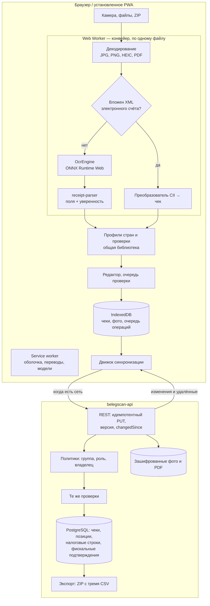

# Волна 3 (Belegscan): схема, план задач, открытые вопросы

## 1. Статус всех ADR

| №               | Решение                                                           | Статус                                                |
| --------------- | ----------------------------------------------------------------- | ----------------------------------------------------- |
| 0007–0012, 0014 | Контракт, конвенции, окружения, вход, права, файлы, развёртывание | Accepted                                              |
| 0013            | Обработка PDF                                                     | Accepted, library pending spike                       |
| 0015            | Почта                                                             | Accepted, provider pending deliverability test        |
| 0016–0020       | Доступ без аккаунта, протокол и удаление, опрос, демо, мониторинг | Accepted                                              |
| 0021, 0022      | Формы; иконки — пишет Claude Code до задачи 8                     | —                                                     |
| 0023            | Распознавание чеков                                               | Proposed, model pending spike (критерии подтверждены) |
| 0024            | Офлайн и синхронизация                                            | Accepted                                              |
| 0025            | Пакетный импорт                                                   | Accepted                                              |
| 0026            | Налоговые строки и фискальные проверки                            | Accepted                                              |
| 0027            | Электронные счета                                                 | Accepted                                              |
| 0028            | Экспорт CSV                                                       | Accepted                                              |

## 2. Схема Belegscan

Одна и та же библиотека проверок работает в браузере (без сети) и на сервере.

## 3. Что нужно от вас

| Что                                                                                                     | Для какой задачи          |
| ------------------------------------------------------------------------------------------------------- | ------------------------- |
| Собрать около 20 реальных чеков (КР и DE) и записать правильные значения полей; хранить только локально | 56                        |
| Телефоны для замера: Redmi Note 12/13 или Galaxy A34/A35, ваш собственный; iPhone, если найдётся        | 56                        |
| Спросить юриста по вопросам 33–38                                                                       | до рабочего использования |

## 4. План задач для Claude Code (продолжение нумерации)

Порядок ваш: спайк → один чек → синхронизация → группы → пакет → электронные счета.
Правила те же. Все эндпоинты — примеры.

**Порядок и зависимости между волнами задаёт `docs/plans/roadmap.md`.** Здесь — описания
задач волны 3. Спайк (56) ни от чего не зависит и идёт параллельно с SignFlow.

### Компоненты `libs/ui`, которых ещё нет в планах

| №     | Компонент                                              | Нужен для                |
| ----- | ------------------------------------------------------ | ------------------------ |
| UI-12 | DatePicker                                             | 34 (срок в SignFlow), 62 |
| UI-13 | Select / Combobox                                      | 34, 62                   |
| UI-14 | BottomNav (мобильная навигация)                        | 61                       |
| UI-15 | Список со свайп-действиями                             | 67                       |
| UI-16 | Chart (столбцы, доли)                                  | 77                       |
| UI-17 | Banner / InlineAlert (офлайн, уведомления о проверках) | 62, 66                   |

UI-12 и UI-13 понадобятся уже в волне 2 (задача 34) — в плане волны 2 они не были названы.

### Этап K. Спайк

| №   | Задача                                                                                                                                                                                                                                                                                                                                                                                                                                                                                                                                                                                         | Рабочий результат                           | Зависит от |
| --- | ---------------------------------------------------------------------------------------------------------------------------------------------------------------------------------------------------------------------------------------------------------------------------------------------------------------------------------------------------------------------------------------------------------------------------------------------------------------------------------------------------------------------------------------------------------------------------------------------- | ------------------------------------------- | ---------- |
| 56  | **Спайк распознавания.** Генератор синтетических чеков (DE, RU, KY) с эталонными значениями; `OcrEngine` и реализация на ONNX; базовый уровень Tesseract.js; скрипт замера по критериям ADR-0023; локальный прогон на реальных чеках из git-игнорируемой папки; проверка CI «картинок вне разрешённых папок нет»; лицензия моделей, заголовки изоляции, Safari на iOS. Результаты отдельно для КР и DE, сумма и дата — отдельными числами; замер на двух размерах рабочей копии; порог высоты строки для подсказки «подойдите ближе». В журнал — только агрегированные числа и модель телефона | Решение о модели с числами; статус ADR-0023 | —          |

### Этап L. Один чек

| №   | Задача                                                                                                                                                                                                                                                                                                                                                                                                                   | Рабочий результат                                             | Зависит от                  |
| --- | ------------------------------------------------------------------------------------------------------------------------------------------------------------------------------------------------------------------------------------------------------------------------------------------------------------------------------------------------------------------------------------------------------------------------ | ------------------------------------------------------------- | --------------------------- |
| 57  | `belegscan-api`: каркас, сквозной срез (health → контракт → клиент → экран), подключение общих библиотек входа и прав, образ и выкат                                                                                                                                                                                                                                                                                     | Вход в Belegscan работает на сервере                          | 9, 24                       |
| 58  | Модель чека по ADR-0026: чек, позиции, налоговые строки, связи, фискальные подтверждения; деньги и десятичные строки                                                                                                                                                                                                                                                                                                     | Миграция и тесты модели                                       | 57, 6                       |
| 59  | Библиотека профилей стран и проверок (`platform:neutral`): DE полностью, KG и общий профиль с умолчаниями; табличные тесты                                                                                                                                                                                                                                                                                               | Проверки одинаковы в браузере и Node                          | 58                          |
| 60  | API чека: идемпотентный PUT по клиентскому id, версия и 409, чтение, список; сервер перепроверяет. Порядок проверок: политика → id → версия → дубликат только для нового id, без совпадения с самим собой. Тест: повтор того же PUT даёт тот же успех, а не `receipt.duplicate`                                                                                                                                          | Чек создаётся дважды одним запросом — один чек                | 58, 59                      |
| 61  | Каркас приложения Belegscan (мобильный и настольный), установка PWA, service worker для оболочки и переводов                                                                                                                                                                                                                                                                                                             | Приложение ставится на телефон и открывается без сети         | 57, UI-14                   |
| 62  | Редактор чека: поля, подсветка уверенности, налоговые строки (0..n), «разница как позиция», уведомления о проверках                                                                                                                                                                                                                                                                                                      | Чек правится вручную и сохраняется онлайн                     | 59, 60, UI-12, UI-13, UI-17 |
| 63  | Камера, рамка, обрезка и перспектива; нормализация по ADR-0025: копия-документ (JPEG q85, до 3000 px, без EXIF/GPS, до 2,5 МБ) и рабочая копия для распознавания; подсказка «подойдите ближе» (порог — после 64). **Проверки по пикселям** на синтетическом чеке 80 × 300 мм со строками 6 и 7 pt: длинная сторона, нет EXIF/GPS, поворот, вес файла, высота строчных букв строки 6 pt на копии-документе не меньше 8 px | Фото готово к распознаванию; копия-документ проходит проверки | 61                          |
| 64  | Распознавание в воркере: модель по итогу спайка, загрузка с прогрессом, кеш моделей в service worker. **Тест чтения:** цифровые строки 6 и 7 pt с копии-документа из задачи 63 читаются движком без ошибок; включить подсказку «подойдите ближе» по порогу из спайка                                                                                                                                                     | Фото превращается в строки текста без сети                    | 56, 63                      |
| 65  | `receipt-parser`: поля и уверенность, ключевые слова из профиля страны; тесты на синтетических чеках                                                                                                                                                                                                                                                                                                                     | Снял чек — редактор заполнен                                  | 59, 64                      |

### Этап M. Синхронизация

| №   | Задача                                                                                                                                                                                                                          | Рабочий результат                         | Зависит от |
| --- | ------------------------------------------------------------------------------------------------------------------------------------------------------------------------------------------------------------------------------- | ----------------------------------------- | ---------- |
| 66  | Локальное хранилище IndexedDB и репозиторий; чек сохраняется офлайн; маркер «не отправлено»; запрос постоянного хранилища                                                                                                       | Чек переживает перезагрузку без сети      | 62         |
| 67  | Список чеков по месяцам из локального хранилища, корзина на 30 дней, свайп-действия                                                                                                                                             | Список работает офлайн                    | 66, UI-15  |
| 68  | Очередь операций и движок синхронизации: порядок, повторы, парковка ошибок 4xx; тесты: перезагрузка посередине, двойная отправка, **потерянный ответ на создание → повтор → успех, а не «дубликат»**                            | Офлайн-чек появляется на сервере один раз | 60, 66     |
| 69  | Загрузка документа (фото, PDF): идемпотентно по id и SHA-256, шифрование на сервере, статус «документ ожидается»                                                                                                                | Фото доезжает после восстановления связи  | 12, 68     |
| 70  | Получение изменений: `changedSince`, курсор, удалённые; окно в три месяца                                                                                                                                                       | Чек коллеги появляется в списке           | 68         |
| 71  | Конфликты: устаревшая версия (две версии рядом), подтверждён другим, в корзине, дубликат                                                                                                                                        | Никто никого не перезаписывает молча      | 70         |
| 72  | Вход и выход офлайн: последний пользователь, очистка при выходе. При неотправленных чеках обычный выход недоступен: «Jetzt synchronisieren» и danger-действие «Nicht hochgeladene Belege verwerfen und abmelden» с числом чеков | Данные не теряются и не достаются чужому  | 68         |

### Этап N. Группы и проверка

| №   | Задача                                                                                                                                                                                                                                                                                              | Рабочий результат                            | Зависит от |
| --- | --------------------------------------------------------------------------------------------------------------------------------------------------------------------------------------------------------------------------------------------------------------------------------------------------- | -------------------------------------------- | ---------- |
| 73  | Группы: создание, владелец, приглашения (в том числе создающие аккаунт), роли, удаление участников; переключатель группы                                                                                                                                                                            | Бухгалтер ведёт несколько групп              | 10, 60     |
| 74  | Политики чеков по ADR-0011: участник, бухгалтер, подтверждённый чек, корзина; матрица доступа                                                                                                                                                                                                       | Права проверены тестами                      | 73         |
| 75  | Подтверждение и история изменений; очередь проверки на компьютере (Prüfwarteschlange)                                                                                                                                                                                                               | Бухгалтер подтверждает чеки                  | 74         |
| 76  | TSE: чтение QR, разбор, сверка сумм, запись как фискальное подтверждение `de-tse`; надпись «TSE-Daten stimmen überein»                                                                                                                                                                              | Немецкий чек показывает результат сверки     | 59, 65     |
| 77  | Аналитика: суммы по валютам раздельно, по категориям и видам налога (только онлайн); все чеки, кроме корзины; фильтр «только подтверждённые» и доля неподтверждённых («Offene Prüfung»)                                                                                                             | Экран «Auswertung»                           | 75, UI-16  |
| 78  | Экспорт: ZIP с тремя CSV и README по ADR-0028; по умолчанию только подтверждённые, переключатель «все (кроме корзины)»; защита от формул по типу столбца; в README — текстовые столбцы и правило снятия апострофа; тест по «золотым» файлам, включая «-10% Rabatt» и возврат с отрицательной суммой | Файл открывается в Excel и читается скриптом | 75         |

### Этап O. Пакет

| №   | Задача                                                                                                                                                                                                                                                                                                                                     | Рабочий результат                             | Зависит от |
| --- | ------------------------------------------------------------------------------------------------------------------------------------------------------------------------------------------------------------------------------------------------------------------------------------------------------------------------------------------ | --------------------------------------------- | ---------- |
| 79  | Очередь пакета в воркере: по одному файлу, прогресс, пауза, отмена, сохранение состояния                                                                                                                                                                                                                                                   | Пачка фото распознаётся с паузой              | 65, 66     |
| 80  | ZIP: чтение оглавления, лимиты до распаковки, подсчёт байт при распаковке; тесты с архивом-бомбой и архивом с ложным оглавлением                                                                                                                                                                                                           | Опасный архив отклоняется с понятной причиной | 79         |
| 81  | HEIC (встроенно или декодер по требованию) и PDF (отрисовка первой страницы). **Проверка: PDF.js работает внутри нашего воркера** (у него свой воркер и холст) — открыть PDF, перечислить вложения, отрисовать страницу в Chrome на Android, Safari на iOS и на компьютере; если нет — шаги с PDF на странице, итог в журнале и в ADR-0025 | Все форматы из макета принимаются             | 79         |
| 82  | Опции пакета: пропуск дубликатов, автоподтверждение (перепроверка сервером), общая категория; сводка                                                                                                                                                                                                                                       | Сводка как на макете                          | 71, 75, 80 |

### Этап P. Электронные счета и демо

| №   | Задача                                                                                                                                                                                                                                                | Рабочий результат                                | Зависит от |
| --- | ----------------------------------------------------------------------------------------------------------------------------------------------------------------------------------------------------------------------------------------------------- | ------------------------------------------------ | ---------- |
| 83  | Электронный счёт: поиск вложения по стандартным именам, разбор CII **на странице через `DOMParser`** (лимит 2 МБ, DOCTYPE отклоняется), преобразователь в чек, пометка источника; тесты на открытых или синтетических образцах, включая XML с DOCTYPE | PDF со счётом становится чеком без распознавания | 59, 81     |
| 84  | Демо Belegscan: seed чеков с разной уверенностью, песочница, выкат на второй сервер                                                                                                                                                                   | Рекрутер пробует Belegscan                       | 50, 52, 75 |

## 5. Принятые ответы владельца (16.11.2026)

1. Критерии спайка — да. Результаты отдельно для КР и DE, «сумма» и «дата» — отдельными
   числами. Средний телефон: Redmi Note 12/13 или Galaxy A34/A35 и собственный телефон
   владельца; Safari на iPhone — отдельно, без порога.
2. Документ чека — нормализованный JPEG; разрешение для хранения и для распознавания
   разные (ADR-0025: q85, до 3000 px, без EXIF/GPS, до 2,5 МБ).
3. TSE в v1 — сверка сумм, надпись «TSE-Daten stimmen überein».
4. «Налог соответствует ставке» — подсказка, допуск 1 минимальная единица на строку.
5. XML без PDF и UBL — v2.
6. Экспорт по умолчанию — только подтверждённые, переключатель «все (кроме корзины)»,
   статус в столбце `status`.
7. Аналитика — все чеки, кроме корзины; фильтр «только подтверждённые» и видимая доля
   неподтверждённых.
8. Дубликаты — в пределах группы.
9. Офлайн-окно — текущий и два предыдущих месяца.
10. Данные на телефоне без шифрования приложением — принято, с честным текстом в
    политике. Выход при неотправленных чеках — по ADR-0024: обычный выход недоступен.
11. История изменений чека — простая запись.

ADR 0024–0028 переведены в Accepted; 0023 — «Proposed, model pending spike».

## 5a. Вопросы, которые были открыты (для истории)

1. **Критерии спайка** (сумма и дата ≥ 90 %, налоги ≥ 80 %, магазин и число позиций
   ≥ 70 %, «уверенные» поля с ошибкой ≤ 5 %, ≤ 5 с на телефоне, ≤ 25 МБ) — подходят?
   Какой телефон считать «средним»?
2. **Что хранить как документ чека:** нормализованный JPEG (меньше места, без координат
   съёмки) или исходный файл как есть? PDF всегда храним исходным. Предлагаю
   нормализованный JPEG.
3. **TSE в v1** — сверка сумм из QR с чеком, без проверки криптографической подписи.
   Подходит? Тогда надпись в интерфейсе: не «TSE geprüft», а, например, «TSE-Daten
   stimmen überein».
4. **Проверка «налог соответствует ставке»** — только подсказка с допуском на округление,
   не ошибка. Подходит? Какой допуск: 1 минимальная единица на налоговую строку?
5. **Отдельные XML-счета без PDF и синтаксис UBL** — v2. Подходит?
6. **Экспорт по умолчанию** — только подтверждённые чеки, с возможностью выбрать все?
7. **Аналитика** считает все чеки или только подтверждённые?
8. **Дубликаты** (магазин + дата + сумма) ищем в пределах группы?
9. **Офлайн-окно** — текущий и два предыдущих месяца. Достаточно?
10. **Данные на телефоне не шифруются приложением** (защита — блокировка телефона).
    Принимаете? Выход из аккаунта при неотправленных чеках — предупреждаем и разрешаем,
    или запрещаем до отправки?
11. **История изменений чека:** простая запись «кто, что, когда» или цепочка хешей, как
    в протоколе SignFlow? Предлагаю простую запись.

## 6. Термины и вопросы юристу

Перенесены в общие документы (перенос волны 3):

- термины волны 3 — в [`docs/glossary.md`](../glossary.md), раздел «Architecture terms»;
- вопросы юристу 33–38 — в [`docs/legal-questions.md`](../legal-questions.md).
