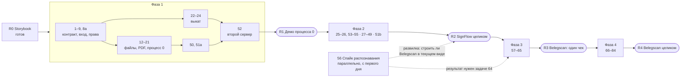

# Сводный план: SignFlow и Belegscan

- Дата: 2026-11-16
- Охватывает: волны 1–3 (ADR 0007–0028), задачи 1–84, компоненты UI-1 … UI-17
- Описания задач — в планах волн (`architecture-wave1.md`, `architecture-wave2.md`, `architecture-wave3.md` в `docs/plans/`).
  **Порядок, зависимости и рубежи задаёт этот файл.** Если план волны говорит иначе,
  прав этот файл.

Правила прежние: одна задача — один PR до ~400 изменённых строк, сначала красный тест,
в конце рабочий результат, зелёный CI и запись в журнале.

## 1. Рубежи

| Рубеж                       | Что можно показать или использовать                                                                                                                                 | Закрывающая задача | Строк в фазе (задачи, компоненты, ADR) |
| --------------------------- | ------------------------------------------------------------------------------------------------------------------------------------------------------------------- | ------------------ | -------------------------------------- |
| **R0. Storybook**           | Библиотека компонентов на GitHub Pages                                                                                                                              | —                  | уже есть                               |
| **R1. Демо процесса 0**     | Рекрутер нажимает «Demo starten», загружает PDF или берёт образец, ставит подпись и печать, скачивает PDF с протоколом. Демо обновляется само после зелёного `main` | 52                 | 38                                     |
| **R2. SignFlow целиком**    | Отправка другим, подписание по ссылке и коду, проверка, протокол с цепочкой хешей, удаление и обезличивание, обзор, мониторинг; в демо — «Demo-Postfach»            | 49                 | 34                                     |
| **R3. Belegscan: один чек** | Снял чек на телефон — редактор заполнен, чек сохранён на сервере                                                                                                    | 65                 | 11                                     |
| **R4. Belegscan целиком**   | Офлайн и синхронизация, группы и роли, проверка, аналитика, экспорт, пакет, электронные счета, демо Belegscan                                                       | 84                 | 21                                     |

Вне фаз идёт одна задача — **56, спайк распознавания**: он ни от чего не зависит.

## 2. Что изменилось относительно планов волн

| Изменение                                                                                                                  | Почему                                                                                                                   |
| -------------------------------------------------------------------------------------------------------------------------- | ------------------------------------------------------------------------------------------------------------------------ |
| Задачи **50** и **52** перенесены из конца волны 2 в конец фазы 1                                                          | Ранний рубеж: первое, что можно потрогать, появляется после процесса 0, а не после подписания внешним участником         |
| Задача 51 разделена: **51a** — страница демо, кнопка «Demo starten», баннер, образцы документов; **51b** — «Demo-Postfach» | 51b нужна задача 37; 51a хватает задачи 21                                                                               |
| 52 зависит от 51a вместо 51                                                                                                | Следствие разделения                                                                                                     |
| В 52 добавлена внешняя проверка доступности адреса демо с письмом при падении                                              | Демо публичное с R1, а тревоги (55) появляются только в фазе 2                                                           |
| Тест «6–7 pt» разделён между 63 (пиксели) и 64 (чтение движком)                                                            | В 63 движка распознавания ещё нет                                                                                        |
| **56** не зависит ни от чего и стоит вне фаз                                                                               | Главный риск Belegscan проверяется до того, как на нём что-то построено                                                  |
| **27** и **28** стоят перед 10                                                                                             | Задача 10 отправляет письмо через порт `Mailer`, а порт и outbox создаёт задача 27. Иначе порт пришлось бы делать дважды |
| 25, 26, 53, 55 идут первыми в фазе 2                                                                                       | Копии, восстановление и тревоги должны работать до первого настоящего документа в рабочей версии                         |
| UI-12 и UI-13 стоят перед 34                                                                                               | В плане волны 2 они не были названы                                                                                      |

До задачи 27 в песочнице писем нет вообще: процесс 0 их не отправляет.

**Сверка с волной 1 — поручение Claude Code.** Строки задач 1–26 записаны здесь не из
файла плана волны 1. Зависимости задачи 16 от компонентов (UI-1, UI-5 … UI-10) и от 8a
восстановлены по таблице «нужен для». Перед началом работ: сверить строки 1–26 и
компоненты UI-1 … UI-10 с планом волны 1 и сообщить владельцу о каждом расхождении;
ничего не исправлять молча.

## 3. Задачи по фазам

Порядок строк — рекомендуемый порядок выполнения для одного исполнителя. Он проверен
скриптом: ни одна задача не стоит раньше своей зависимости, а фаза 1 содержит ровно то,
без чего задача 52 невозможна.

### Вне фаз

| №   | Задача                                                        | Рабочий результат                           | Зависит от | Волна |
| --- | ------------------------------------------------------------- | ------------------------------------------- | ---------- | ----- |
| 56  | **Спайк распознавания** на синтетике и ваших чеках (локально) | Решение о модели с числами; статус ADR-0023 | —          | 3     |

Когда начинать: как только собраны чеки и записаны правильные значения полей. Код спайка
не пересекается с SignFlow, поэтому его можно вести второй сессией Claude Code в
отдельной ветке или вставить между любыми двумя задачами фазы 1.

### Фаза 1. До рубежа «демо процесса 0»

| №        | Задача                                                                                                                   | Рабочий результат                                                 | Зависит от                                        | Волна |
| -------- | ------------------------------------------------------------------------------------------------------------------------ | ----------------------------------------------------------------- | ------------------------------------------------- | ----- |
| 1        | Сквозной срез: `health` → контракт → Orval-клиент → экран → тесты                                                        | Экран показывает версию API                                       | —                                                 | 1     |
| 2        | `api:check` в CI, границы Nx                                                                                             | Расхождение контракта ломает CI                                   | 1                                                 | 1     |
| 3        | Ошибки RFC 9457, коды → переводы                                                                                         | Ошибка валидации на de/en/ru                                      | 2                                                 | 1     |
| 4        | Настройки с проверкой при старте, `/config`                                                                              | Неверная переменная останавливает запуск                          | 2                                                 | 1     |
| 5        | PostgreSQL, Prisma, Testcontainers, миграции в CI                                                                        | Интеграционный тест ходит в базу                                  | 4                                                 | 1     |
| 6        | `api-kit`: страницы, `Money`, таблица валют ISO 4217, UUIDv7                                                             | Библиотека с тестами                                              | 3, 5                                              | 1     |
| ADR-0021 | Формы в приложениях (пишет Claude Code)                                                                                  | Решение записано                                                  | —                                                 | 1     |
| ADR-0022 | Иконки `lucide-angular` (пишет Claude Code)                                                                              | Решение записано                                                  | —                                                 | 1     |
| UI-1     | Spinner / Progress                                                                                                       | Компонент в Storybook                                             | —                                                 | 1     |
| UI-2     | Toast                                                                                                                    | Компонент в Storybook                                             | —                                                 | 1     |
| 7        | Сессии: вход, выход, cookie, ограничение попыток                                                                         | Вход через API                                                    | 5                                                 | 1     |
| 8        | Экран входа, хранилище сессии, guard                                                                                     | Можно войти и выйти в браузере                                    | 7, ADR-0021, ADR-0022, UI-1, UI-2                 | 1     |
| UI-4     | SideNav                                                                                                                  | Компонент в Storybook                                             | —                                                 | 1     |
| 8a       | Каркас SignFlow: меню, шапка, язык                                                                                       | Вошедший видит каркас                                             | 8, UI-4                                           | 1     |
| 9        | Авторизация: «запрещено по умолчанию», `@Policy`                                                                         | Маршрут без политики не проходит CI                               | 7                                                 | 1     |
| 22       | Образы: Dockerfile, сборка один раз, e2e на образах                                                                      | Образ в реестре после зелёного `main`                             | 8                                                 | 1     |
| 23       | `compose.yaml`, Caddy, миграции, runbook сервера                                                                         | Стек поднимается одной командой                                   | 22                                                | 1     |
| 24       | Выкат кнопкой с автооткатом                                                                                              | Версия выкатывается и откатывается                                | 23                                                | 1     |
| 12       | `FileStore` и конвертное шифрование, ротация ключа                                                                       | Файл шифруется и читается                                         | 5                                                 | 1     |
| 13       | **Спайк PDF** на синтетическом наборе                                                                                    | Библиотека выбрана, статус ADR-0013                               | —                                                 | 1     |
| 14       | Проверка загрузки PDF в изолированном потоке                                                                             | Плохие PDF отклоняются с кодом                                    | 3, 13                                             | 1     |
| 15       | Документ: модель, загрузка, отпечаток, список                                                                            | PDF виден в списке через API                                      | 6, 9, 12, 14                                      | 1     |
| UI-3     | Dialog                                                                                                                   | Компонент в Storybook                                             | —                                                 | 1     |
| UI-5     | Breadcrumbs                                                                                                              | Компонент в Storybook                                             | —                                                 | 1     |
| UI-6     | DataTable                                                                                                                | Компонент в Storybook                                             | —                                                 | 1     |
| UI-7     | Pagination                                                                                                               | Компонент в Storybook                                             | —                                                 | 1     |
| UI-8     | Tabs                                                                                                                     | Компонент в Storybook                                             | —                                                 | 1     |
| UI-9     | FileDrop                                                                                                                 | Компонент в Storybook                                             | —                                                 | 1     |
| UI-10    | DropdownMenu                                                                                                             | Компонент в Storybook                                             | —                                                 | 1     |
| 16       | Фронт: загрузка PDF и список документов                                                                                  | Экран «Dokumente» работает                                        | 8a, 15, UI-1, UI-5, UI-6, UI-7, UI-8, UI-9, UI-10 | 1     |
| 17       | Профиль: подпись и печати                                                                                                | Подпись и печати сохраняются                                      | 12, 16, UI-3, UI-9                                | 1     |
| 18       | Простановка в PDF: координаты, картинка, текст                                                                           | Тесты на наборе PDF зелёные                                       | 13, 15                                            | 1     |
| 19       | Страница протокола, итоговый отпечаток, скачивание                                                                       | Итоговый PDF с протоколом скачивается                             | 18                                                | 1     |
| 20       | Фронт: просмотр страниц (PDF.js), размещение полей                                                                       | Поля ставятся на страницу                                         | 16                                                | 1     |
| 21       | Фронт: окно подписи, печать, согласие; e2e процесса 0                                                                    | **Процесс 0 работает целиком**                                    | 17, 19, 20, UI-3, UI-8                            | 1     |
| 50       | Режим песочницы: временный пользователь, seed, очистка, лимиты                                                           | «Demo starten» через API создаёт аккаунт                          | 9, 15                                             | 2     |
| 51a      | Страница демо: кнопка «Demo starten», баннер, образцы документов                                                         | Посетитель проходит процесс 0                                     | 21, 50                                            | 2     |
| 52       | Второй сервер: Compose для демо, автовыкат после зелёного `main`, `noindex`; внешняя проверка доступности демо с письмом | **Демо в интернете, обновляется само; о падении приходит письмо** | 24, 51a                                           | 2     |

### Фаза 2. До рубежа «SignFlow целиком»

| №     | Задача                                                   | Рабочий результат                                    | Зависит от                   | Волна |
| ----- | -------------------------------------------------------- | ---------------------------------------------------- | ---------------------------- | ----- |
| 53    | Журналы JSON, `/health/live`, `/health/ready`            | Журнал без личных данных                             | 4                            | 2     |
| 25    | Копии restic каждые 6 часов, heartbeat                   | Копия появляется в хранилище                         | 24                           | 1     |
| 26    | Проверка восстановления на чистом сервере                | Восстановление доказано                              | 12, 25                       | 1     |
| 55    | Внешние проверки, сигналы жизни, runbook инцидента       | Остановленное задание даёт тревогу                   | 25, 53                       | 2     |
| 54    | Отчёты об ошибках: SDK, очистка, Bugsink                 | Ошибка видна в трекере без личных данных             | 52, 53                       | 2     |
| 27    | Порт `Mailer`, outbox, транспорты                        | Письмо уходит в Mailpit после фиксации               | 5                            | 2     |
| 28    | Шаблоны писем de/en/ru                                   | Письма на трёх языках                                | 27                           | 2     |
| 10    | Приглашения: создание, письмо, принятие                  | Новый пользователь входит по приглашению             | 8a, 9, 27, UI-3, UI-6, UI-10 | 1     |
| 11    | Восстановление пароля, смена e-mail, письмо о блокировке | Пароль можно сбросить                                | 10                           | 1     |
| 29    | Почтовый провайдер, DNS, отказы; **тест доставки**       | Письмо во «Входящих» на всех ящиках; статус ADR-0015 | 24, 28                       | 2     |
| 30    | Лимиты отправки и предохранитель                         | Превышение даёт понятную ошибку                      | 27                           | 2     |
| 31    | Модель участников и порядок                              | API черновика с участниками                          | 15                           | 2     |
| 32    | Автомат состояний документа                              | Недопустимый переход даёт 409                        | 31                           | 2     |
| UI-11 | Stepper                                                  | Компонент в Storybook                                | —                            | 2     |
| 33    | Фронт «Neuer Umlauf»: участники и порядок                | Участники добавляются                                | 16, 31, UI-11                | 2     |
| UI-12 | DatePicker                                               | Компонент в Storybook                                | —                            | 2     |
| UI-13 | Select / Combobox                                        | Компонент в Storybook                                | —                            | 2     |
| 34    | Фронт: поля по участникам, срок, сообщение               | Черновик готов к отправке                            | 20, 33, UI-12, UI-13         | 2     |
| 35    | Отправка через outbox, порядок подписания                | Подписант получает письмо                            | 28, 32                       | 2     |
| 36    | Доступ по ссылке и коду, блокировка                      | Вход по ссылке и коду через API                      | 9, 35                        | 2     |
| 37    | Экран подписания для участника                           | **Внешний подписант подписывает**                    | 21, 36                       | 2     |
| 51b   | Экран «Demo-Postfach»                                    | Посетитель проходит путь отправителя и подписанта    | 37, 51a                      | 2     |
| 38    | «Входящие» для подписанта с аккаунтом                    | Документ появляется в Eingang                        | 35                           | 2     |
| 39    | Проверка перед подписанием, замена PDF                   | Этап «In Prüfung» работает                           | 36                           | 2     |
| 40    | Сопровождение: напомнить, аннулировать, продлить         | Действия отправителя работают                        | 35                           | 2     |
| 41    | Завершение: протокол, итоговый PDF, письма               | Все участники получают результат                     | 19, 37                       | 2     |
| 42    | Цепочка хешей протокола                                  | Изменение записи обнаруживается                      | 15                           | 2     |
| 43    | `verify`: команда и ночное задание                       | Сбой цепочки даёт тревогу                            | 42, 55                       | 2     |
| 44    | Удаление с сохранением доказательства                    | Остаются отпечатки и протокол                        | 42                           | 2     |
| 45    | Обезличивание и псевдонимизация по ADR-0017              | Цепочка сходится, меток в базе нет                   | 36, 42                       | 2     |
| 46    | Экран «Details»: протокол, целостность, CSV              | Экран на настоящих данных                            | 41, 42                       | 2     |
| 47    | ETag, 304, помощник опроса                               | Статус обновляется сам                               | 16                           | 2     |
| 48    | Обзор: ждут меня, ждут других, просрочено                | Главный экран SignFlow                               | 38, 47                       | 2     |
| 49    | Массовые действия и поиск                                | Действия для нескольких документов                   | 40                           | 2     |

### Фаза 3. До рубежа «Belegscan: один чек»

| №     | Задача                                                                          | Рабочий результат                                    | Зависит от                  | Волна |
| ----- | ------------------------------------------------------------------------------- | ---------------------------------------------------- | --------------------------- | ----- |
| 57    | `belegscan-api`: каркас, сквозной срез, вход, выкат                             | Вход в Belegscan работает на сервере                 | 9, 24                       | 3     |
| 58    | Модель чека по ADR-0026                                                         | Миграция и тесты модели                              | 6, 57                       | 3     |
| 59    | Профили стран и проверки (общая библиотека)                                     | Проверки одинаковы в браузере и Node                 | 58                          | 3     |
| 60    | API чека: идемпотентный PUT, версия, 409; сначала id, потом поиск дубликата     | Двойной запрос — один чек, повтор не даёт «дубликат» | 58, 59                      | 3     |
| UI-14 | BottomNav                                                                       | Компонент в Storybook                                | —                           | 3     |
| 61    | Каркас Belegscan, PWA, service worker                                           | Приложение ставится на телефон                       | 57, UI-14                   | 3     |
| UI-17 | Banner / InlineAlert                                                            | Компонент в Storybook                                | —                           | 3     |
| 62    | Редактор чека: поля, уверенность, налоговые строки                              | Чек правится и сохраняется онлайн                    | 59, 60, UI-12, UI-13, UI-17 | 3     |
| 63    | Камера, обрезка, нормализация (две копии), проверки копии-документа по пикселям | Фото готово, копия-документ проходит проверки        | 61                          | 3     |
| 64    | Распознавание в воркере, кеш моделей; тест «цифры 6–7 pt читаются движком»      | Фото превращается в строки без сети                  | 56, 63                      | 3     |
| 65    | `receipt-parser`: поля и уверенность                                            | **Снял чек — редактор заполнен**                     | 59, 64                      | 3     |

### Фаза 4. До рубежа «Belegscan целиком»

| №     | Задача                                                              | Рабочий результат                            | Зависит от | Волна |
| ----- | ------------------------------------------------------------------- | -------------------------------------------- | ---------- | ----- |
| 66    | IndexedDB, чек сохраняется офлайн                                   | Чек переживает перезагрузку без сети         | 62         | 3     |
| UI-15 | Список со свайп-действиями                                          | Компонент в Storybook                        | —          | 3     |
| 67    | Список по месяцам офлайн, корзина                                   | Список работает офлайн                       | 66, UI-15  | 3     |
| 68    | Очередь операций и синхронизация; тест потерянного ответа           | Офлайн-чек появляется на сервере один раз    | 60, 66     | 3     |
| 69    | Загрузка документа (фото, PDF)                                      | Фото доезжает после восстановления связи     | 12, 68     | 3     |
| 70    | Получение изменений, окно в три месяца                              | Чек коллеги появляется в списке              | 68         | 3     |
| 71    | Конфликты: версия, подтверждён, корзина, дубликат                   | Никто никого не перезаписывает молча         | 70         | 3     |
| 72    | Вход и выход офлайн; выход при неотправленных чеках                 | Данные не теряются и не достаются чужому     | 68         | 3     |
| 73    | Группы, приглашения, роли                                           | Бухгалтер ведёт несколько групп              | 10, 60     | 3     |
| 74    | Политики чеков, матрица доступа                                     | Права проверены тестами                      | 73         | 3     |
| 75    | Подтверждение, история изменений, очередь проверки                  | Бухгалтер подтверждает чеки                  | 74         | 3     |
| 76    | TSE: QR, сверка сумм                                                | Немецкий чек показывает результат сверки     | 59, 65     | 3     |
| UI-16 | Chart                                                               | Компонент в Storybook                        | —          | 3     |
| 77    | Аналитика                                                           | Экран «Auswertung»                           | 75, UI-16  | 3     |
| 78    | Экспорт: ZIP с тремя CSV и README                                   | Файл открывается в Excel и читается скриптом | 75         | 3     |
| 79    | Очередь пакета в воркере                                            | Пачка фото распознаётся с паузой             | 65, 66     | 3     |
| 80    | ZIP с лимитами, тесты с архивом-бомбой                              | Опасный архив отклоняется                    | 79         | 3     |
| 81    | HEIC и PDF; проверка PDF.js внутри нашего воркера                   | Все форматы из макета принимаются            | 79         | 3     |
| 82    | Опции пакета и сводка                                               | Сводка как на макете                         | 71, 75, 80 | 3     |
| 83    | Электронный счёт (ZUGFeRD / XRechnung, CII), разбор XML на странице | PDF со счётом становится чеком               | 59, 81     | 3     |
| 84    | Демо Belegscan                                                      | **Рекрутер пробует Belegscan**               | 50, 52, 75 | 3     |

## 4. Что можно вести параллельно

- **56** — с чем угодно.
- **Компоненты UI** — параллельно с задачами API; каждый нужен к первой задаче, которая
  на него ссылается.
- **22–24 (выкат)** — сразу после задачи 8, параллельно с 12–21. Чем раньше пройден путь
  до сервера, тем меньше сюрпризов перед R1.
- **42–45 (протокол и удаление)** — после 15 и 36, параллельно с экранами 37–41.
- **Фаза 3** технически возможна после задач 9 и 24. Порядок «сначала SignFlow целиком»
  — ваш; его можно пересмотреть после результата спайка.

## 5. Развилки

| Развилка                     | Когда               | Что решается                                                                                                                                                                                        |
| ---------------------------- | ------------------- | --------------------------------------------------------------------------------------------------------------------------------------------------------------------------------------------------- |
| Спайк PDF (13)               | фаза 1              | Библиотека для ADR-0013. При провале — вторая библиотека на том же наборе                                                                                                                           |
| **Спайк распознавания (56)** | до начала фазы 3    | Три исхода по ADR-0023. Если суммы или даты на кыргызских чеках не проходят, **до задачи 57** решаем, строить ли Belegscan в текущем виде: ручной ввод этих полей, другая модель или другой порядок |
| Тест доставки (29)           | фаза 2              | Почтовый провайдер для ADR-0015                                                                                                                                                                     |
| Ответы юриста                | до настоящих данных | Вопрос 33 (фото чека как документ) может изменить правило хранения в ADR-0025; сроки хранения протокола включаются после ответа                                                                     |

## 6. Что нужно от вас

Макеты исправлены, включая надпись «TSE-Daten stimmen überein».

| К какому моменту    | Что                                                                                                                                                                              |
| ------------------- | -------------------------------------------------------------------------------------------------------------------------------------------------------------------------------- |
| Сейчас              | Около 20 чеков (КР и DE) с правильными значениями полей, только локально; телефоны для замера: Redmi Note 12/13 или Galaxy A34/A35, ваш собственный, iPhone — если найдётся (56) |
| До задачи 23–24     | Домен, первый сервер, DNS-записи, GitHub Environment `production` с подтверждением                                                                                               |
| До задачи 51a       | Обновить `business-processes.md` §0: кнопка «Demo starten» вместо логина и пароля                                                                                                |
| До задачи 52        | **Второй сервер** и поддомен демо. Раньше он был нужен к концу волны 2, теперь — к R1. Аккаунт во внешнем сервисе проверок — тоже к этой задаче                                  |
| До задачи 25        | Хранилище копий в ЕС у другого провайдера                                                                                                                                        |
| До задачи 55        | Канал Telegram для тревог                                                                                                                                                        |
| До задачи 29        | Аккаунт почтового провайдера, DNS для `mail.<домен>`, тестовые ящики                                                                                                             |
| До настоящих данных | Ответы юриста на вопросы 1–38                                                                                                                                                    |

## 7. Компоненты `libs/ui`

| №     | Компонент                                                            | Первая задача, которой нужен |
| ----- | -------------------------------------------------------------------- | ---------------------------- |
| —     | Button, FormField/Input, Checkbox, Radio, Switch, Badge, Avatar, Tag | готовы                       |
| UI-1  | Spinner / Progress                                                   | 8                            |
| UI-2  | Toast                                                                | 8                            |
| UI-3  | Dialog                                                               | 17                           |
| UI-4  | SideNav                                                              | 8a                           |
| UI-5  | Breadcrumbs                                                          | 16                           |
| UI-6  | DataTable                                                            | 16                           |
| UI-7  | Pagination                                                           | 16                           |
| UI-8  | Tabs                                                                 | 16                           |
| UI-9  | FileDrop                                                             | 16                           |
| UI-10 | DropdownMenu                                                         | 16                           |
| UI-11 | Stepper                                                              | 33                           |
| UI-12 | DatePicker                                                           | 34                           |
| UI-13 | Select / Combobox                                                    | 34                           |
| UI-14 | BottomNav                                                            | 61                           |
| UI-15 | Список со свайп-действиями                                           | 67                           |
| UI-16 | Chart                                                                | 77                           |
| UI-17 | Banner / InlineAlert                                                 | 62                           |

## 8. Статус ADR

| №               | Решение                                                                   | Статус                                                     |
| --------------- | ------------------------------------------------------------------------- | ---------------------------------------------------------- |
| 0007–0012, 0014 | Контракт, конвенции, окружения, вход, права, файлы, развёртывание         | Accepted                                                   |
| 0013            | Обработка PDF                                                             | Accepted, library pending spike (задача 13)                |
| 0015            | Почта                                                                     | Accepted, provider pending deliverability test (задача 29) |
| 0016–0020       | Доступ без аккаунта, протокол и удаление, опрос, демо, мониторинг         | Accepted                                                   |
| 0021, 0022      | Формы; иконки                                                             | пишет Claude Code до задачи 8                              |
| 0023            | Распознавание чеков                                                       | Proposed, model pending spike (задача 56)                  |
| 0024–0028       | Офлайн, пакетный импорт, налоговые строки, электронные счета, экспорт CSV | Accepted                                                   |
